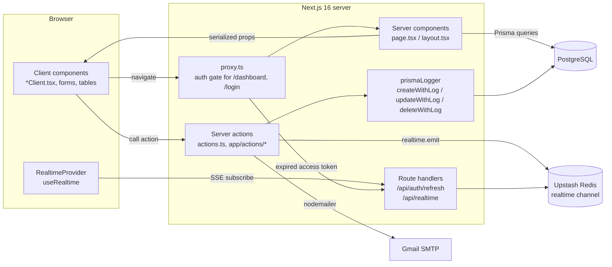
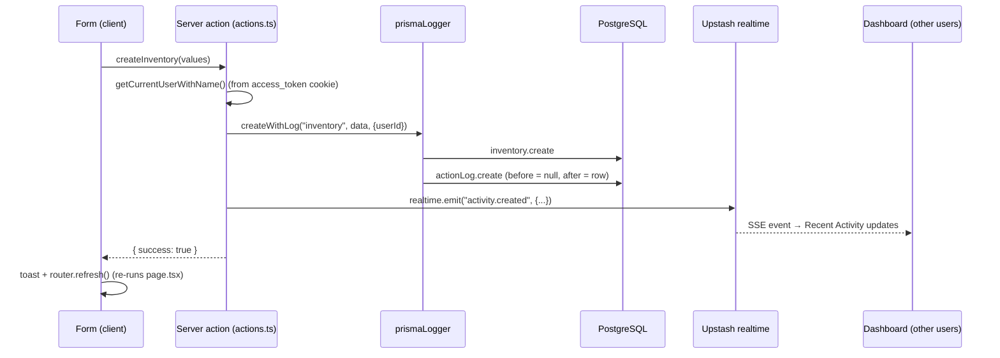

# 03 · Architecture

## High-level view

Everything is one Next.js app. There is no separate backend service: server code runs inside Next.js as **React Server Components** (reads) and **server actions** (writes).



## Folder structure

```text
.
├── app/
│   ├── (auth)/                  # Public auth pages (route group, no URL segment)
│   │   ├── login/               #   /login
│   │   ├── forgotPassword/      #   /forgotPassword
│   │   ├── register/[token]/    #   /register/<inviteToken>
│   │   ├── resetPassword/[token]/  /resetPassword/<resetToken>
│   │   └── AuthProvider.tsx     #   React context exposing the user's role name
│   ├── actions/                 # Auth server actions (login, logout, refresh, register, reset, change password)
│   ├── api/
│   │   ├── auth/refresh/route.ts  # Rotates tokens, then redirects back
│   │   ├── realtime/route.ts      # Upstash realtime SSE endpoint
│   ├── dashboard/               # Everything behind login
│   │   ├── layout.tsx           #   Loads the current user, wraps in AuthProvider + shell
│   │   ├── layout-wrapper.tsx   #   Sidebar + header + RealtimeProvider (client)
│   │   ├── page.tsx             #   Dashboard home (server data → DashboardClient)
│   │   ├── loading.tsx / error.tsx
│   │   ├── _dashboard-components/  # Dashboard widgets (charts, panels, restock list)
│   │   ├── inventory/ category/ supplier/ purchase/ reports/
│   │   │     page.tsx           #   Server: query + serialize
│   │   │     *Client.tsx        #   Client: permissions, table, modal, form
│   │   │     actions.ts         #   Server actions for the module
│   │   │     components/        #   Table, form, view modal…
│   │   ├── accessManagement/    #   users/ roles/ + actions/{users,roles}.ts + schema.ts
│   │   ├── profile/             #   Profile + change password
│   │   └── utils/               #   formatPeso, status config, Excel export, progress bar
│   ├── generated/prisma/        # Generated Prisma client (gitignored)
│   ├── globals.css              # Tailwind v4 + theme tokens (light/dark)
│   └── layout.tsx               # Root: fonts, ThemeProvider, Toaster, metadata
├── components/                  # Shared app components (Custom*, DataTable, PageCard…)
│   └── ui/                      # shadcn/ui primitives
├── lib/
│   ├── auth.ts                  # getCurrentUser* helpers (read JWT cookie)
│   ├── auth-guard.ts            # requirePermission() for server code
│   ├── jwt.ts / cookies.ts      # Sign/verify JWTs, set/clear auth cookies
│   ├── prisma.ts                # Prisma client singleton (pg adapter)
│   ├── permissions/usePermission.ts  # Client-side can("module:action")
│   ├── types/prismaLogger.ts    # CRUD wrappers that write ActionLog rows
│   ├── upstash/                 # Redis client + typed realtime schema
│   └── email/                   # Nodemailer transport + HTML templates
├── prisma/
│   ├── schema.prisma            # Data model
│   ├── migrations/              # 20 SQL migrations
│   ├── seed.ts + data/*.json    # Seed script and its data
├── proxy.ts                     # Next 16 "proxy" (formerly middleware): auth redirects
└── prisma.config.ts             # Prisma 7 config (schema path, seed command, DB URL)
```

## How a page works (read path)

Each module follows the same split:

1. **`page.tsx` (server component)** runs Prisma queries in `Promise.all`, converts `Decimal`/`Date` values to `number`/ISO strings (client components can't receive `Decimal`), and loads the current user's permissions with `getCurrentUserWithDetails()`.
2. **`*Client.tsx` (client component)** receives the plain data plus `permissions`. It uses `usePermission(permissions).can("inventory:read")` to show or hide the page and its buttons, and renders `DataTable`, `CustomModal` and the form.

Example: [`app/dashboard/inventory/page.tsx`](../app/dashboard/inventory/page.tsx) → [`InventoryClient.tsx`](../app/dashboard/inventory/InventoryClient.tsx).

## How a write works (server action)



After a successful action, the client calls `router.refresh()` to re-render the server component with fresh data. Only the role actions use `revalidatePath`.

## Authentication at the edge

[`proxy.ts`](../proxy.ts) runs for `/dashboard/:path*` and `/login`:

- `/login` with a valid access token redirects to `/dashboard`.
- `/dashboard/*`:
  - with a valid access token, the request goes through;
  - with a valid refresh token only, it redirects to `/api/auth/refresh?returnTo=<path>`, which rotates tokens and redirects back;
  - with neither, it redirects to `/login`.

Full flows are in [07 – Auth & security](./07-auth-and-security.md).

## Realtime activity feed

- [`lib/upstash/realtime.ts`](../lib/upstash/realtime.ts) defines a typed schema with one event, `activity.created` (`action`, `module`, `submodule`, `recordId`, `user`, `createdAt`).
- Server actions call `realtime.emit(...)` after each write.
- [`app/api/realtime/route.ts`](../app/api/realtime/route.ts) exposes the Upstash `handle()` endpoint. [`layout-wrapper.tsx`](../app/dashboard/layout-wrapper.tsx) wraps the dashboard in `<RealtimeProvider api={{ url: "/api/realtime" }}>`.
- [`dashboardClient.tsx`](../app/dashboard/_dashboard-components/dashboardClient.tsx) subscribes with `useRealtime` and prepends new events to the "Recent Activity" list.

## Key design decisions (as seen in the code)

| Decision | Why it fits / trade-off |
|---|---|
| **Server actions instead of a REST API** | Less boilerplate and type-safe calls from forms. Trade-off: actions are public POST endpoints, so every action must check auth and permissions itself (most don't yet; see 07). |
| **JWT in httpOnly cookies + DB-backed refresh sessions** | Stateless 15-minute access token checked in the proxy. Refresh tokens are hashed in `Session` and rotated on every refresh, so they can be revoked. |
| **Permissions loaded from the DB, not stored in the JWT** | The access token holds only `userId` + `roleId`. Permissions are read from the DB each request, so role changes apply immediately (noted in `todo's.ts`, 2/8/2026). |
| **Generic audit logging wrapper** | `createWithLog` / `updateWithLog` / `deleteWithLog` take a model name and write a before/after JSON snapshot to `ActionLog`, so every module is audited the same way. |
| **Inventory status stored, not calculated on read** | `computeInventoryStatus()` runs on create, update and purchase receipt, which keeps filtering and counting by status simple. `discontinued` is a manual override. |
| **`unitPrice` is per unit** | Value = `quantity × unitPrice` everywhere (dashboard, category totals, reports, table). |
| **Prisma client generated into `app/generated/prisma`** | Prisma 7's `prisma-client` generator with a custom output; imported as `@/app/generated/prisma/...`. |
| **One component per UI concept** | `CustomDropdown` (menus, single and multi select), `CustomButton`, `DataTable`, `PageCard`. Keeps styling consistent and theme-aware. |
