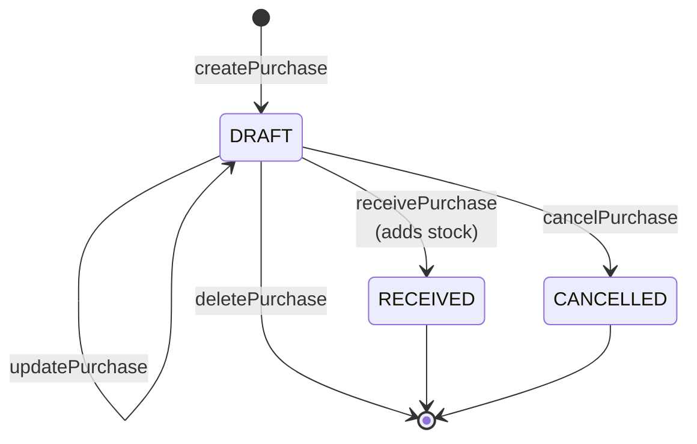

# 04 · Backend

The "backend" is the server side of the Next.js app:

- **3 route handlers** under `app/api/`
- **Server actions** (`"use server"` files) called directly from client components
- **Server components** (`page.tsx`) that query the database for reads

There is no REST/GraphQL API for third parties.

## Server setup

| Piece | File | Notes |
|---|---|---|
| Prisma client | [`lib/prisma.ts`](../lib/prisma.ts) | `PrismaClient` with the `PrismaPg` adapter (`DATABASE_URL`). Cached on `globalThis` outside production to survive hot reload. |
| Auth helpers | [`lib/auth.ts`](../lib/auth.ts) | `getCurrentUser()` → `{ userId, roleId }` from the `access_token` cookie (or `null`). `getCurrentUserWithName()` adds `fullName`. `getCurrentUserWithDetails()` adds email, phone and role with its permissions. |
| Permission guard | [`lib/auth-guard.ts`](../lib/auth-guard.ts) | `requirePermission("module:action[:submodule]")` redirects to `/login` (no session) or `/dashboard/no-permission` (missing permission). |
| Audit logging | [`lib/types/prismaLogger.ts`](../lib/types/prismaLogger.ts) | See [Audit log](#audit-log). |
| Realtime | [`lib/upstash/realtime.ts`](../lib/upstash/realtime.ts) | `realtime.emit("activity.created", payload)` |
| Email | [`lib/email/index.ts`](../lib/email/index.ts) | `sendInviteEmail(to, token)`, `sendResetPasswordEmail(to, token)` |
| Edge auth | [`proxy.ts`](../proxy.ts) | See [03](./03-architecture.md#authentication-at-the-edge) / [07](./07-auth-and-security.md) |

## Route handlers

| Method | Path | Purpose | Auth | Request | Response | File |
|---|---|---|---|---|---|---|
| `GET` | `/api/auth/refresh` | Rotate the refresh session and issue new tokens, then go back to the page the user was on | Needs a valid `refresh_token` cookie | Query: `returnTo` (default `/dashboard`) | `307` redirect to `returnTo` on success, or to `/login` on any error | [`app/api/auth/refresh/route.ts`](../app/api/auth/refresh/route.ts) |
| `GET` | `/api/realtime` | Upstash Realtime stream (SSE) for the activity feed | ⚠️ None: `/api` isn't covered by `proxy.ts` | Managed by `@upstash/realtime` client | Event stream | [`app/api/realtime/route.ts`](../app/api/realtime/route.ts) |
| `GET` | `/api/test-edit-user` | ⚠️ **Debug leftover.** Calls `editUserAction` with hard-coded dummy IDs to test authorization | None | none | `200` JSON if the edit succeeded, `403` JSON `{ message, error }` if it threw | [`app/api/test-edit-user/route.ts`](../app/api/test-edit-user/route.ts) |

> ⚠️ Remove `/api/test-edit-user` before deploying (see [07](./07-auth-and-security.md#security-findings)).

## Server actions

Server actions are called like functions from client components. They signal errors by **throwing `Error`**, and callers catch them and show a toast. "Permission check" below means a **server-side** check. The UI hides buttons based on permissions, but that isn't enforced on the server.

### Auth: `app/actions/`

| Action | File | Purpose | Input | Returns / side effects | Errors thrown |
|---|---|---|---|---|---|
| `loginAction` | [`auth.login.ts`](../app/actions/auth.login.ts) | Check credentials, create a session, set cookies | `{ email, password }` | Creates a `Session` (bcrypt hash of the refresh token, 7-day expiry), sets the `access_token` + `refresh_token` cookies, returns `{ success: true }` | `Invalid form data`, `Invalid email or password` |
| `logoutAction` | [`auth.logout.ts`](../app/actions/auth.logout.ts) | Revoke sessions, clear cookies | none (used as a `<form action>`) | Redirects to `/login`. ⚠️ Revokes **all** non-revoked sessions in the table, not just the caller's | none |
| `refreshAction` | [`auth.refresh.ts`](../app/actions/auth.refresh.ts) | Rotate tokens (used by `/api/auth/refresh`) | none (reads cookie) | Revokes the matched session, creates a new one, sets new cookies | `No refresh token`, `Invalid session`, `User not found`, or a JWT verification error |
| `registerUserAction` | [`auth.register.ts`](../app/actions/auth.register.ts) | Accept an invite and create the account | `{ token, password, phoneNumber }` | In one transaction: create the `User` (active, email verified) and delete the `UserInvite` | `Invalid token`, `Token expired`, `User already registered` |
| `forgotPasswordAction` | [`auth.forgot-password.ts`](../app/actions/auth.forgot-password.ts) | Start a password reset | `{ email }` | If the user exists: creates a `PasswordReset` (32-byte hex token, 30-minute expiry) and emails the link. Returns silently either way, so it doesn't reveal which emails exist | none |
| `resetPasswordAction` | [`auth.reset-password.ts`](../app/actions/auth.reset-password.ts) | Set a new password from a reset link | `{ token, password }` | In one transaction: update the password and mark the token `usedAt` | `Invalid token`, `Token already used`, `Token expired` |
| `changePasswordAction` | [`auth.change-password.ts`](../app/actions/auth.change-password.ts) | Change password from the profile page | `(currentPassword, newPassword)` | In one transaction: update the password and revoke all of the user's sessions | `Unauthorized`, `User not found`, `Current password is incorrect` |

### Inventory: [`app/dashboard/inventory/actions.ts`](../app/dashboard/inventory/actions.ts)

| Action | Input | Behaviour | Permission check | Errors |
|---|---|---|---|---|
| `createInventory` | `InventoryFormValues` (`name, description?, quantity, minimumStock, unitPrice, unit, categoryId, discontinued`) | Calculates `status` with `computeInventoryStatus(quantity, minimumStock, discontinued)`, then `createWithLog` + emit | ❌ | Prisma errors (for example a duplicate `name`) |
| `updateInventory` | `(id, InventoryFormValues)` | Recalculates `status`, then `updateWithLog` + emit | ❌ | `Inventory ID is required for editing`, `Inventory not found` |
| `deleteInventory` | `id` | `deleteWithLog` + emit | ❌ | `Inventory ID is required`, `Inventory not found`. ⚠️ Fails with a foreign-key error if any `PurchaseItem` references the item |

### Category: [`app/dashboard/category/actions.ts`](../app/dashboard/category/actions.ts)

| Action | Input | Behaviour | Permission check | Errors |
|---|---|---|---|---|
| `createCategory` | `{ name, description?, icon?, color? }` | `createWithLog` + emit | ❌ | Prisma unique error on `name` |
| `updateCategory` | `(id, values)` | `updateWithLog` + emit | ❌ | `Category ID is required for editing`, `Category not found` |
| `deleteCategory` | `id` | `deleteWithLog` + emit. Inventories **cascade-delete** | ❌ | same as above. ⚠️ Fails if any of its inventories have purchase items |

### Supplier: [`app/dashboard/supplier/actions.ts`](../app/dashboard/supplier/actions.ts)

| Action | Input | Behaviour | Permission check | Errors |
|---|---|---|---|---|
| `createSupplier` | `{ name, email, phone, address, notes? }` | `createWithLog` + emit | ❌ | Prisma unique error on `name` |
| `updateSupplier` | `(id, values)` | `updateWithLog` + emit | ❌ | `Supplier ID is required for editing`, `Supplier not found` |
| `deleteSupplier` | `id` | `deleteWithLog` + emit | ❌ | same. ⚠️ Fails if the supplier has purchases (no cascade) |

### Purchase: [`app/dashboard/purchase/actions.ts`](../app/dashboard/purchase/actions.ts)

| Action | Input | Behaviour | Permission check | Errors |
|---|---|---|---|---|
| `createPurchase` | `PurchaseFormValues` (`supplierId, notes?, items[{inventoryId, quantity, unitCost}]`) | `total = Σ quantity × unitCost`. Creates the purchase and nested items with status `DRAFT` | ❌ | Prisma errors |
| `updatePurchase` | `(id, values)` | DRAFT only. Deletes all items, then updates the purchase with recreated items and a new total | ❌ | `Purchase not found`, `Only DRAFT purchases can be edited` |
| `receivePurchase` | `id` | DRAFT only. For each item: `inventory.quantity += item.quantity`, then recalculates that item's status (keeping `discontinued`). Then sets the purchase to `RECEIVED` | ❌ | `Purchase not found`, `Only DRAFT purchases can be received` |
| `cancelPurchase` | `id` | DRAFT only. Sets `CANCELLED` | ❌ | `Purchase not found`, `Only DRAFT purchases can be cancelled` |
| `deletePurchase` | `id` | DRAFT only. `deleteWithLog` (items cascade) | ❌ | `Purchase not found`, `Only DRAFT purchases can be deleted` |

> ⚠️ `updatePurchase` and `receivePurchase` run several queries **without a transaction**. If something fails partway, the data can be left inconsistent (items deleted but the purchase not updated, or stock added but the status still `DRAFT`).

### Access management: users ([`actions/users.ts`](../app/dashboard/accessManagement/actions/users.ts))

| Action | Input | Behaviour | Permission check | Errors |
|---|---|---|---|---|
| `inviteUserAction` | `UserFormValues` (`firstName, lastName, email, roleId`) | Rejects emails that already have a user or an invite. Creates a `UserInvite` (32-byte token, 7-day expiry), logs, emits, sends the invite email | ✅ `access-management:create:users` | `First name is required`, `Last name is required`, `Email is required`, `Role is required`, `User already exists`, `An invitation has already been sent to this email` |
| `editUserAction` | `UserFormValues` with `id` | Updates a `User` (email, role, isActive) or a `UserInvite` (email, role), whichever the id matches | ❌ | `User ID is required for editing`, `User or invite not found` |
| `deleteAccessAction` | `(id, "USER" \| "INVITE")` | Deletes the user or the invite | ❌ (only checks that someone is logged in) | `Unauthorized.`, `You cannot delete your own account.`, `User not found`, `Invite not found` |
| `getUsers` / `getInvites` / `getRoles` | none | Read helpers used by the users page | ❌ | none |

### Access management: roles ([`actions/roles.ts`](../app/dashboard/accessManagement/actions/roles.ts))

| Action | Input | Behaviour | Permission check | Errors |
|---|---|---|---|---|
| `createRoleAction` | `RoleFormValues` (`name, description, permissionIds[]`) | Validates with `roleSchema.parse` (Zod), checks the name is unique, creates the role with its permissions, `revalidatePath("/roles")` | ❌ | Zod error, `Role with this name already exists` |
| `updateRoleAction` | `(id, values)` | Same validation, then replaces the permission set (`set`) | ❌ | same |
| `deleteRoleAction` | `id` | Blocks deleting your own role or a role still assigned to users or invites. Disconnects permissions, then deletes | ❌ | `Role not found`, `You cannot delete role that has been assigned to you.`, `Cannot delete role. N user(s) are assigned.`, `Cannot delete role. N invite(s) are assigned.` |
| `getRolesCount` / `getRoleById` / `getAllPermissions` | none | Read helpers | ❌ | none |

> ⚠️ `revalidatePath("/roles")` and `revalidatePath("/roles/<id>/edit")` use paths that don't exist (the real path is `/dashboard/accessManagement/roles`), so they do nothing.

### Other

| Function | File | Notes |
|---|---|---|
| `getRecentActivity` | [`app/dashboard/_dashboard-hooks/index.tsx`](../app/dashboard/_dashboard-hooks/index.tsx) | Last 10 `ActionLog` rows. The dashboard page queries `actionLog` directly instead. |

## Business logic

| Rule | Where |
|---|---|
| **Inventory status:** `discontinued` if set manually; else `out_of_stock` if qty = 0; else `in_stock` if min ≤ 0; ratio ≤ 1 → `warning`; ratio ≤ 1.5 → `low_stock`; otherwise `in_stock` | `computeInventoryStatus` in [`app/dashboard/utils/index.ts`](../app/dashboard/utils/index.ts) |
| **Value** = `quantity × unitPrice` (price is per unit) | dashboard, category page, reports, inventory table |
| **Purchase total** = Σ `quantity × unitCost`, worked out on the server from submitted items | `createPurchase`, `updatePurchase` |
| **Only DRAFT purchases** can be edited, received, cancelled or deleted | purchase actions |
| **Receiving** increments stock and recalculates status | `receivePurchase` |
| **Discontinued items** can't be added to new purchase lines (UI filter) and are left out of restock alerts | [`PurchaseForm.tsx`](../app/dashboard/purchase/components/PurchaseForm.tsx), [`app/dashboard/page.tsx`](../app/dashboard/page.tsx) |
| **Dashboard metrics:** spend is grouped by `createdAt` month (there's no `receivedAt` field); trend = this month vs last month | [`app/dashboard/page.tsx`](../app/dashboard/page.tsx) |

## Audit log

`createWithLog(model, data, { userId, submodule }, options?)`, `updateWithLog(model, where, data, ctx, options?)` and `deleteWithLog(model, where, ctx, { include?, before? })`:

1. Run the Prisma operation on `prisma[model]`.
2. Insert an `ActionLog` row with `module = model name`, `action`, `recordId`, and `before` / `after` JSON snapshots.

> ⚠️ The log row is inserted **after** the main write, outside a transaction. `module` is the Prisma model name (`userInvite`, `role`…), not the permission module (`access-management`). `todo's.ts` notes this as unresolved.

## Validation

| Layer | What happens |
|---|---|
| Client | Every form uses React Hook Form + `zodResolver`. Schemas live next to the form (for example `inventorySchema` in [`InventoryClient.tsx`](../app/dashboard/inventory/InventoryClient.tsx), `purchaseSchema` in [`purchase/schema.ts`](../app/dashboard/purchase/schema.ts), `userFormSchema` / `roleSchema` in [`accessManagement/schema.ts`](../app/dashboard/accessManagement/schema.ts)). |
| Server | Only `createRoleAction` / `updateRoleAction` re-validate with Zod. `inviteUserAction` checks required fields by hand. ⚠️ Every other action trusts its input. |
| Database | Unique constraints (names, emails, tokens), enums, foreign keys. |

## Error handling

- Actions `throw new Error("…")`. Client code wraps calls in `try/catch` and shows `showToast.error(...)` ([`lib/toast.ts`](../lib/toast.ts)), usually with a generic "Something went wrong".
- Unexpected render errors in `/dashboard/*` are caught by [`app/dashboard/error.tsx`](../app/dashboard/error.tsx).
- There's no structured logging. A few `console.log`s remain (for example in `/api/auth/refresh`).

## External integrations

| Service | Used for | Config |
|---|---|---|
| PostgreSQL | All data | `DATABASE_URL` |
| Upstash Redis / Realtime | Live activity feed | `UPSTASH_REDIS_REST_URL`, `UPSTASH_REDIS_REST_TOKEN` |
| Gmail SMTP (Nodemailer) | Invite and reset emails. Templates in [`lib/email/templates/`](../lib/email/templates) | `GMAIL_USER`, `GMAIL_PASS`, `SMTP_USER`, `NEXT_PUBLIC_APP_URL` |

> ⚠️ **Gaps / TODO**
> - Add `requirePermission(...)` to every mutating action (see [07](./07-auth-and-security.md#security-findings)).
> - Re-validate inputs on the server with the same Zod schemas.
> - Wrap multi-step writes (purchase update and receive, plus the audit log insert) in `prisma.$transaction`.
> - The email transport sets `service: "gmail"` together with `port: 465, secure: false`. Nodemailer's `service` preset overrides host and port, but the settings contradict each other.
