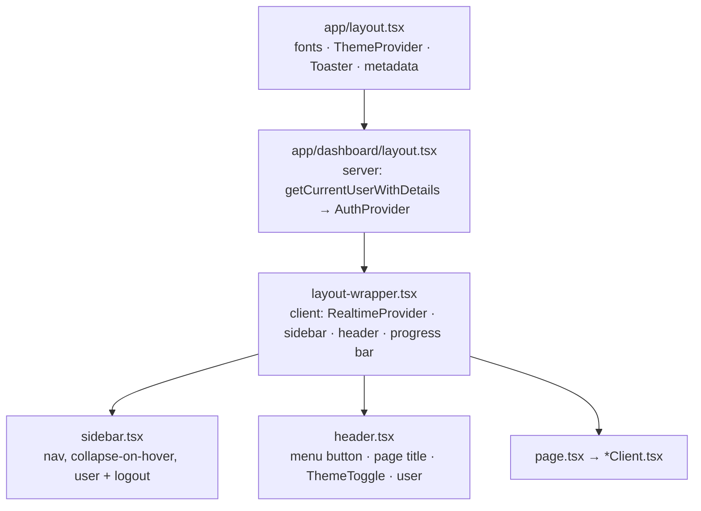

# 05 · Frontend

## Routes

| URL | File | Access | Client permission gate |
|---|---|---|---|
| `/` | [`app/page.tsx`](../app/page.tsx) | Public | Redirects to `/login` |
| `/login` | [`app/(auth)/login/page.tsx`](../app/(auth)/login/page.tsx) | Public (redirects to `/dashboard` if already logged in) | none |
| `/forgotPassword` | [`app/(auth)/forgotPassword/page.tsx`](../app/(auth)/forgotPassword/page.tsx) | Public | none |
| `/register/[token]` | [`app/(auth)/register/[token]/page.tsx`](../app/(auth)/register/[token]/page.tsx) + `form.tsx` | Public, valid invite token | none |
| `/resetPassword/[token]` | [`app/(auth)/resetPassword/[token]/page.tsx`](../app/(auth)/resetPassword/[token]/page.tsx) + `form.tsx` | Public, valid reset token | none |
| `/dashboard` | [`app/dashboard/page.tsx`](../app/dashboard/page.tsx) | Logged in | ⚠️ none (`dashboard:read` exists but isn't checked) |
| `/dashboard/inventory` | [`inventory/page.tsx`](../app/dashboard/inventory/page.tsx) | Logged in | `inventory:read` |
| `/dashboard/category` | [`category/page.tsx`](../app/dashboard/category/page.tsx) | Logged in | `category:read` |
| `/dashboard/supplier` | [`supplier/page.tsx`](../app/dashboard/supplier/page.tsx) | Logged in | `supplier:read` |
| `/dashboard/purchase` | [`purchase/page.tsx`](../app/dashboard/purchase/page.tsx) | Logged in | `purchase:read` |
| `/dashboard/reports` | [`reports/page.tsx`](../app/dashboard/reports/page.tsx) | Logged in | `reports:read` |
| `/dashboard/accessManagement/users` | [`accessManagement/users/page.tsx`](../app/dashboard/accessManagement/users/page.tsx) | Logged in | `access-management:read:users` |
| `/dashboard/accessManagement/roles` | [`accessManagement/roles/page.tsx`](../app/dashboard/accessManagement/roles/page.tsx) | Logged in | `access-management:read:roles` |
| `/dashboard/accessManagement/roles/add` | [`roles/add/page.tsx`](../app/dashboard/accessManagement/roles/add/page.tsx) | Logged in | none |
| `/dashboard/accessManagement/roles/[id]/edit` | [`roles/[id]/edit/page.tsx`](../app/dashboard/accessManagement/roles/[id]/edit/page.tsx) | Logged in | none |
| `/dashboard/profile` | [`profile/page.tsx`](../app/dashboard/profile/page.tsx) | Logged in | none |
| `/dashboard/no-permission` | [`no-permission/page.tsx`](../app/dashboard/no-permission/page.tsx) | Logged in | Target of `requirePermission` |

> ⚠️ `/dashboard/accessManagement` ([`page.tsx`](../app/dashboard/accessManagement/page.tsx)) redirects to `/access-management/users`, which doesn't exist (404). The sidebar links directly to `/users` and `/roles`, so users don't normally hit this.

Every dashboard route also has [`loading.tsx`](../app/dashboard/loading.tsx) (skeleton) and [`error.tsx`](../app/dashboard/error.tsx) (error card with "Try again"). Page titles are set with `export const metadata = { title }` and the template `%s · Bean Counter` in [`app/layout.tsx`](../app/layout.tsx).

## App shell

- **Desktop (`md`+):** the sidebar sits on the left and the header button collapses it to icons (it expands on hover while collapsed).
- **Below `md`:** the sidebar is hidden, and the header button opens it as a slide-over with a backdrop. Picking a link or tapping the backdrop closes it.
- [`NavigationProgress`](../app/dashboard/utils/ProgressBar.tsx) shows a thin bar during route changes.

Access management has its own [`layout.tsx`](../app/dashboard/accessManagement/layout.tsx) that renders a Users / Roles tab bar ([`NavigationRoute.tsx`](../app/dashboard/accessManagement/components/NavigationRoute.tsx)) above both pages.

> ⚠️ Each `navItems` entry in [`sidebar.tsx`](../app/dashboard/sidebar.tsx) has a `permission` field, but it isn't used for filtering, so everyone sees every link.

## Module pattern

Each feature module looks like this (Inventory as the example):

| File | Role |
|---|---|
| `page.tsx` | Server: query, serialize Decimals and Dates, load permissions |
| `InventoryClient.tsx` | Client: `usePermission`, stats cards, `PageCard`, table, create/edit `CustomModal`. Also exports the Zod schema and types |
| `components/inventoryTable.tsx` | Column definitions for `DataTable`, row actions (view/edit/delete), filters, Excel export |
| `components/inventoryForm.tsx` | React Hook Form + Zod form that calls the server action |
| `components/inventoryViewModal.tsx` | Read-only detail view (with purchase history) |
| `actions.ts` | Server actions |

## Shared components (`components/`)

| Component | What it does |
|---|---|
| [`CustomButton`](../components/CustomButton.tsx) | **The** button. Variants: `default, destructive, outline, secondary, ghost, link, sidebar, sidebar-active`. Sizes: `default, xs, sm, lg, icon, icon-sm, icon-lg, nav`. `loading` shows a spinner and disables the button. `asChild` renders onto a child element (for example `Link`). Defaults to `type="button"`. Also exports `buttonVariants`. |
| [`CustomDropdown`](../components/CustomDropdown.tsx) | **The** dropdown, in two modes. *Menu mode* (`trigger` + `children` or `(close) => children`). *Select mode* (`label, options, value, onChange`) with a searchable list, keyboard navigation (↑ ↓ Enter Esc), `multiple` for multi-select (`string[]`), an optional custom `trigger`, and `portal` rendering so menus aren't clipped inside modals. Also exports `DropdownItem`, `DropdownHeader`, `DropdownDivider`. |
| [`DataTable`](../components/DataTable.tsx) | Generic table: text search, multi-select filters (`filters: {key,label,options}[]`, a row matches any selected value), optional date-range filter (`dateRangeKey`), pagination (10 rows), empty states with "Clear filters", `numeric` columns (right-aligned, tabular digits), `defaultSearch` to jump to a row by id. |
| [`PageCard`](../components/PageCard.tsx) | Standard page surface (border, `bg-card`, padding) with optional `title`, `description`, `actions`. |
| [`StatsCard`](../components/StatsCard.tsx) | KPI card with icon, colour (`default/warning/danger/success`), optional trend and click-to-filter. |
| [`CustomModal`](../components/CustomModal.tsx) | Dialog wrapper (title, description, footer, sizes). |
| [`CustomInput`](../components/CustomInput.tsx) | Labelled input/textarea with required marker, error text, prefix/suffix, password toggle. |
| [`CustomTooltip`](../components/CustomTooltip.tsx) | Tooltip. When `content` is a string, it's also used as the child's `aria-label`. |
| [`CustomDateRange`](../components/CustomDateRange.tsx) | Date-range filter (popover calendar with Clear/Apply). |
| [`LogoutButton`](../components/LogoutButton.tsx) | Logout with a confirmation modal (`variant="icon" \| "text"`). |
| [`ThemeProvider`](../components/ThemeProvider.tsx) / [`ThemeToggle`](../components/ThemeToggle.tsx) | `next-themes` (class strategy, follows the system by default) and the sun/moon toggle. |
| [`Spinner`](../components/Spinner.tsx) | Loading spinner. |
| `components/ui/*` | shadcn/ui primitives (badge, calendar, card, chart, checkbox, dialog, input, label, popover, table, tooltip…). `select.tsx` and `dropdown-menu.tsx` are no longer imported anywhere (replaced by `CustomDropdown`). `navigation-menu.tsx` is used only by the Users/Roles tab bar. |

Dashboard-only widgets live in [`app/dashboard/_dashboard-components/`](../app/dashboard/_dashboard-components): `DashboardPanel`, `SpendOverTimeChart`, `CategoryValueChart`, `TopSuppliersChart`, `InventoryStatusChart` (Stock Health), `ReorderList`, `dashboardClient`.

## State management

There's no global store. State lives in:

- **Server components:** the source of truth. After a mutation, the client calls `router.refresh()`.
- **Local `useState`:** modal open/close, the record being edited, table search/filter/page, status-card filters.
- **React Hook Form:** form state.
- **`AuthProvider`** context ([`app/(auth)/AuthProvider.tsx`](../app/(auth)/AuthProvider.tsx)): exposes the user's **role name** (`useAuth().hasRole`). ⚠️ Nothing calls `useAuth()` yet, so the provider is unused.
- **`usePermission(permissions)`**: a memoized `can("module:action[:submodule]")` built from the permissions the page passes in.
- **Realtime:** `useRealtime` in `dashboardClient.tsx` pushes new activity into local state.

## Forms and validation

All forms use **React Hook Form + `zodResolver`**:

| Form | Schema location | Notable rules |
|---|---|---|
| Login | `login/page.tsx` | Valid email; password required |
| Register | `register/[token]/form.tsx` | Password ≥ 6, must match confirmation; phone `^\+?[0-9]{10,15}$` |
| Reset password | `resetPassword/[token]/form.tsx` | Password ≥ 8 |
| Inventory | `InventoryClient.tsx` (`inventorySchema`) | Name ≤ 50; numbers ≥ 0; `discontinued` boolean |
| Category | `CategoryClient.tsx` | Name 1–50; icon ≤ 5 chars (emoji) |
| Supplier | `SupplierClient.tsx` | Email; phone `^\+?[\d\s\-()]{7,20}$`; address ≤ 255 |
| Purchase | `purchase/schema.ts` | ≥ 1 item; quantity ≥ 1; unit cost ≥ 0 |
| User invite/edit | `accessManagement/schema.ts` | Names and email required only when inviting (no `id`) |
| Role | `accessManagement/schema.ts` | Name required; `permissionIds[]` |

> ⚠️ Password rules aren't consistent: 6 characters at registration, 8 on reset and change-password.

## Styling and theme

- **Tailwind CSS v4** configured in CSS ([`app/globals.css`](../app/globals.css)): `@theme inline` maps utilities to CSS variables, and `@custom-variant dark` keys off the `.dark` class.
- **Palette:** Black `#000000`, Prussian Blue `#14213d`, Orange `#fca311`, Alabaster Grey `#e5e5e5`, White `#ffffff`.
  - Light mode: primary = Prussian Blue, ring and accents = Orange.
  - Dark mode: primary = Orange on black/navy surfaces.
- **Use the tokens, not raw colours:** `bg-background`, `bg-card`, `text-foreground`, `text-muted-foreground`, `bg-primary`, `text-destructive`, `border-border`, `bg-sidebar-*`, `--chart-1…5`.
- **Status colours** are fixed (green/amber/orange/red/grey) and shared through `badgeTones`, `inventoryStatusConfig` and `purchaseStatusConfig` in [`app/dashboard/utils/index.ts`](../app/dashboard/utils/index.ts).
- **Formatting helpers** in the same file: `formatPeso` (₱ with thousands separators), `formatUnit`, `formatStatus`, `formatDate`.

## Accessibility notes

- ✅ Icon-only buttons get `aria-label`s (directly or through `CustomTooltip`). Pagination buttons are labelled.
- ✅ Select-mode dropdowns support ↑ ↓ Enter Esc. Escape closes any `CustomDropdown`.
- ✅ The loading skeleton sets `aria-busy`. The theme toggle has an `aria-label`.
- ⚠️ `CustomDropdown` doesn't use ARIA `listbox`/`option` roles, so screen readers don't announce it as a select.
- ⚠️ The dashboard's clickable activity rows and the restock list are `div`s with `onClick`, so they can't be reached with the keyboard.
- ⚠️ No automated accessibility checks.
