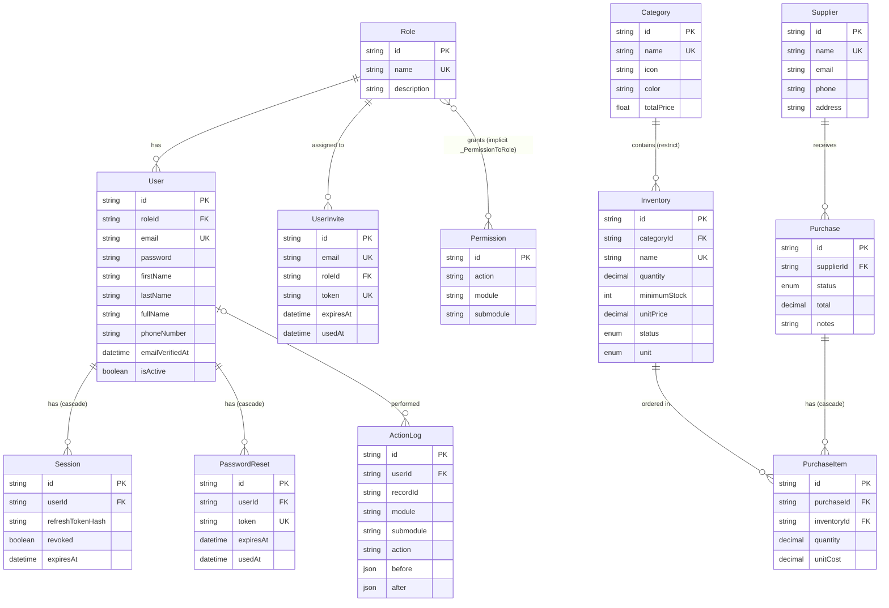

# 06 · Database

- **Engine:** PostgreSQL
- **ORM:** Prisma 7, using the `prisma-client` generator with output to `app/generated/prisma`
- **Schema:** [`prisma/schema.prisma`](../prisma/schema.prisma)
- **Config:** [`prisma.config.ts`](../prisma.config.ts) (schema path, migrations path, seed command, `DATABASE_URL`)

All primary keys are UUID strings (`@default(uuid())`). Most business tables have the audit columns `createdAt`, `createdBy`, `updatedAt`, `updatedBy`. Note that `createdBy`/`updatedBy` store the user's **full name** as text, not a foreign key.

## ER diagram

## Models

### Access and auth

**`Role`**

| Column | Type | Constraints / notes |
|---|---|---|
| `id` | `String` | PK, uuid |
| `name` | `String` | **unique** |
| `description` | `String?` | |
| `createdAt` / `createdBy` / `updatedAt` / `updatedBy` | | audit |
| relations | `users User[]`, `invites UserInvite[]`, `permissions Permission[]` | many-to-many with `Permission` |

**`Permission`**

| Column | Type | Constraints / notes |
|---|---|---|
| `id` | `String` | PK |
| `action` | `String` | `read` / `create` / `update` / `delete` |
| `module` | `String` | e.g. `inventory`, `access-management` |
| `submodule` | `String` | default `""` (used as `users` / `roles` under `access-management`) |
| audit columns | | |
| | | **unique** `(action, module, submodule)`; **index** `module` |

**`User`**

| Column | Type | Constraints / notes |
|---|---|---|
| `id` | `String` | PK |
| `roleId` | `String` | FK → `Role.id` (no cascade, so a role can't be deleted while users have it). **index** |
| `email` | `String` | **unique** |
| `password` | `String` | bcrypt hash (cost 10) |
| `firstName`, `lastName`, `phoneNumber` | `String` | required |
| `fullName` | `String?` | set to `"first last"` by the app |
| `emailVerifiedAt` | `DateTime?` | set at registration |
| `isActive` | `Boolean` | default `false` (set to `true` at registration) |
| audit columns | | |

**`UserInvite`**: `email` **unique**, `firstName`, `lastName`, `roleId` FK (**index**), `token` **unique**, `expiresAt`, `usedAt?`, audit columns. The row is deleted when the invite is accepted.

**`Session`**: `userId` FK (**cascade delete**, **index**), `refreshTokenHash` (bcrypt of the refresh JWT), `revoked` (default `false`), `expiresAt`. ⚠️ No `createdAt`. Old rows are never cleaned up.

**`PasswordReset`**: `userId` FK (**cascade delete**, **index**), `token` **unique** (stored as plain text), `expiresAt`, `usedAt?`, `createdAt`.

**`ActionLog`** (audit trail)

| Column | Type | Notes |
|---|---|---|
| `userId` | `String?` | FK → `User` (optional; Prisma's default `SetNull` on delete). **index** |
| `recordId` | `String?` | id of the affected row |
| `module` | `String` | Prisma model name. **index** |
| `submodule` | `String?` | **index** |
| `action` | `String` | `create` / `update` / `delete`. **index** |
| `before` / `after` | `Json?` | full row snapshots |
| `createdAt` | `DateTime` | default `now()` |

### Inventory and purchasing

**`Category`**: `name` **unique**, `description?`, `icon?` (emoji), `color?` (hex), `totalPrice Float` (default 0), audit columns.

> ⚠️ `Category.totalPrice` is never written. The category page works out the total on read (`Σ quantity × unitPrice`). It's also a `Float`, while money elsewhere uses `Decimal` (the `todo's.ts` note from 2/17 suggests changing it).

**`Inventory`**

| Column | Type | Notes |
|---|---|---|
| `categoryId` | `String` | FK → `Category` (**restrict**: a category can't be deleted while it has items), **index** |
| `name` | `String` | **unique** |
| `description` | `String?` | |
| `quantity` | `Decimal` | default 0 (decimal so it can hold weights and volumes) |
| `minimumStock` | `Int` | default 0 |
| `unitPrice` | `Decimal` | default 0, **price per one unit** |
| `status` | `InventoryStatus?` | stored and recalculated on write |
| `unit` | `InventoryUnit` | required |
| audit columns | | |

**`Supplier`**: `name` **unique**, `email?`, `phone?`, `address?`, `notes?`, audit columns.

**`Purchase`**: `supplierId` FK → `Supplier` (no cascade), `status PurchaseStatus` (default `DRAFT`), `notes?`, `total Decimal` (default 0), audit columns.

**`PurchaseItem`**: `purchaseId` FK → `Purchase` (**cascade delete**), `inventoryId` FK → `Inventory` (no cascade, so an inventory item used in any purchase **can't be deleted**), `quantity Decimal`, `unitCost Decimal`.

> ⚠️ `PurchaseItem` has no indexes on `purchaseId` or `inventoryId`. Postgres doesn't index foreign keys automatically, so add `@@index` if those tables grow.

### Enums

| Enum | Values |
|---|---|
| `InventoryStatus` | `in_stock`, `low_stock`, `out_of_stock`, `warning`, `discontinued` |
| `InventoryUnit` | `PCS`, `KG`, `G`, `L`, `ML` (the UI shows them lowercase) |
| `PurchaseStatus` | `DRAFT`, `RECEIVED`, `CANCELLED` |

## Migrations

20 migrations in [`prisma/migrations/`](../prisma/migrations), from `20260111012110_added_session` to `20260314031405_organize_schema`.

| Task | Command |
|---|---|
| Apply migrations in development (and create new ones from schema changes) | `npx prisma migrate dev` / `npx prisma migrate dev --name <change>` |
| Apply migrations in production / CI | `npx prisma migrate deploy` |
| Reset the dev DB (drop, migrate, seed) | `npx prisma migrate reset` |
| Check status | `npx prisma migrate status` |
| Regenerate the client after schema changes | `npx prisma generate` (also part of `npm run build`) |

## Seed data

`npx prisma db seed` runs [`prisma/seed.ts`](../prisma/seed.ts) with `tsx`. It uses upserts (and skips purchases if any exist), so it's safe to run more than once. The data lives in [`prisma/data/`](../prisma/data):

| File | Rows | What's created |
|---|---|---|
| `permissions.json` | 27 | `read/create/update/delete` for `inventory`, `category`, `supplier`, `purchase`, plus `access-management` × `users`/`roles`, plus `access-management:read:logs`, `dashboard:read` and `reports:read` |
| `roles.json` | 4 | `ADMIN` (`"all"`), `MODERATOR` (module list + extras), `INVENTORY_CLERK` (inventory + read access, can draft purchases), `USER` (`"read_only"` = every `read` permission) |
| `users.json` | 7 | At least one user per role, plus one **inactive** user (`grace@example.com`). **Plain-text starter passwords** (`Password123`) are hashed while seeding |
| `invites.json` | 2 | One pending and one expired invite (random tokens; no email is sent) |
| `categories.json` | 9 | Café categories with emoji icons and colours |
| `inventories.json` | 47 | Items linked by category name. `status` is computed with `computeInventoryStatus`, and the data includes low, critical, out-of-stock and discontinued items |
| `suppliers.json` | 12 | Suppliers with PH contact details |
| `purchases.json` | 28 | Purchases over the last ~6 months (dates are `daysAgo`, relative to when you seed): received, cancelled and 4 drafts. Each gets `ActionLog` rows so the activity feed has history. Seeded inventory quantities are treated as current stock, so received purchases don't add to them |

> `MODERATOR` lists whole modules (`category`, `inventory`, `supplier`, `purchase`) plus single permissions in `extra` (`dashboard:read`, `reports:read`, `access-management:read:users`, `access-management:read:roles`). The seed fails if `roles.json` names a module that doesn't exist.

## Row-level security / access rules

**There is no row-level security.** The app connects with a single database user, and access control happens only in application code (see [07](./07-auth-and-security.md)). Every logged-in user can read every row through the pages, as long as the server code allows it.
