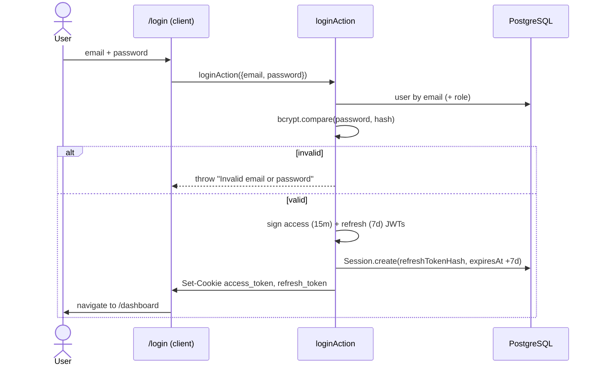
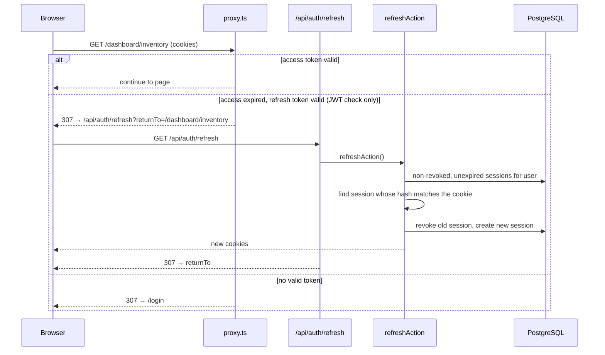
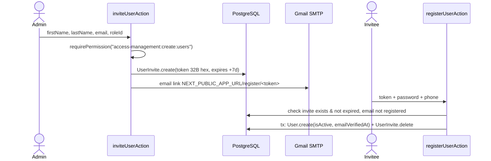

# 07 · Auth & security

## Overview

| Concern | Implementation | Files |
|---|---|---|
| Passwords | bcrypt (`bcryptjs`, cost 10) | `app/actions/auth.*.ts` |
| Tokens | Two HS256 JWTs signed with `jose`. Issuer `coffee-inventory`, audience `web` | [`lib/jwt.ts`](../lib/jwt.ts) |
| Access token | `sub = userId`, claim `roleId`, **15 min** | `signAccessToken` |
| Refresh token | `sub = userId`, **7 days**. Its bcrypt hash is stored in `Session` | `signRefreshToken`, `Session` model |
| Cookies | `access_token`, `refresh_token`: `httpOnly`, `secure`, `sameSite=lax`, `path=/` | [`lib/cookies.ts`](../lib/cookies.ts) |
| Route protection | `proxy.ts` (Next 16's renamed middleware) for `/dashboard/:path*` and `/login` | [`proxy.ts`](../proxy.ts) |
| Authorization | Role → permissions (`module:action[:submodule]`) | [`lib/auth-guard.ts`](../lib/auth-guard.ts), [`lib/permissions/usePermission.ts`](../lib/permissions/usePermission.ts) |
| Account creation | Invite-only (admin sends an emailed link with a 7-day token) | [`actions/users.ts`](../app/dashboard/accessManagement/actions/users.ts), [`auth.register.ts`](../app/actions/auth.register.ts) |

## Login

## Request to a protected page and token refresh

**Token rotation:** every refresh revokes the old `Session` and creates a new one, so a used refresh token can't be replayed.

## Invite and registration

## Password reset

1. `/forgotPassword` → `forgotPasswordAction({ email })`. If the user exists, it creates a `PasswordReset` (32-byte token, **30 min**) and emails `/resetPassword/<token>`. It returns the same response whether or not the email exists.
2. `/resetPassword/[token]` → `resetPasswordAction`. It checks the token exists, is unused and hasn't expired, then, in one transaction, sets the new password hash and marks `usedAt`.
3. Changing the password from the profile page (`changePasswordAction`) also **revokes all of that user's sessions**.

## Authorization model

- A **permission** is `(module, action, submodule)`, written as a string `module:action` or `module:action:submodule`. Examples: `inventory:update`, `access-management:create:users`.
- A **role** has many permissions, and each user has one role.
- The **27 seeded permissions** cover `read/create/update/delete` for `inventory`, `category`, `supplier`, `purchase`, and `access-management:{users,roles}`, plus `access-management:read:logs`, `dashboard:read` and `reports:read` (see [06](./06-database.md#seed-data)).
- Permissions are **not** stored in the JWT. They're read from the DB on each request (`getCurrentUserWithDetails`, `requirePermission`), so role changes apply on the next request.

There are two ways permissions get checked:

| Mechanism | Where | Effect |
|---|---|---|
| `requirePermission(p)` (server) | Top of **every** dashboard server action, read helper and `page.tsx` | Redirects to `/dashboard/no-permission` if missing. This is the real security boundary. The lookup is cached per request (`getPermissionStrings`) |
| `usePermission(perms).can(p)` (client) | Every `*Client.tsx` / table, and the sidebar | Hides pages, buttons and nav links. UI only, **not a security boundary** |

## Protected routes

- `proxy.ts` matcher: `/dashboard/:path*`, `/login`.
- **Not covered:** `/api/*` and the auth pages (public on purpose). `/api/realtime` checks the session cookie itself (valid access or refresh token, active user).
- Server actions are POST requests to the page that renders them. Those under `/dashboard` go through the proxy, so an **unauthenticated** caller gets redirected. Each action then calls `requirePermission`, so an authenticated user without the permission is redirected to `/dashboard/no-permission`.

## Secret handling

- All secrets come from environment variables (see [02](./02-getting-started.md#environment-variables)). `.env*` is gitignored except `.env.example`, which contains no real values.
- Use separate random values for `ACCESS_TOKEN_SECRET` and `REFRESH_TOKEN_SECRET`. Rotating either one logs everyone out.
- `GMAIL_PASS` must be a Google App Password.
- ⚠️ [`prisma/data/users.json`](../prisma/data/users.json) holds **plain-text starter passwords** and is committed. Treat them as public and change them on any shared environment.

## Rate limiting

[`lib/upstash/ratelimit.ts`](../lib/upstash/ratelimit.ts) uses `@upstash/ratelimit` (sliding window) on the existing Upstash Redis:

| Endpoint | Per IP | Per email |
|---|---|---|
| Login | 20 / minute | 10 / 15 min, reset after a successful login |
| Forgot password | 10 / hour | 3 / hour |

If Redis is unreachable, the check **fails open** (logs and allows), so an Upstash outage doesn't lock everyone out. The token endpoints (`/api/auth/refresh`, reset/register by token) aren't limited; their tokens are 32 random bytes or signed JWTs.

## Security findings

Found by reading the code. Ordered by severity.

| # | Severity | Finding | Location | Suggested fix | Status |
|---|---|---|---|---|---|
| 1 | 🔴 High | **Missing server-side authorization.** Every inventory, category, supplier, purchase and role action, plus `editUserAction` and `deleteAccessAction`, runs for any logged-in user regardless of role. Only the UI hides the buttons. | `app/dashboard/*/actions.ts`, `accessManagement/actions/*.ts` | Call `await requirePermission("<module>:<action>")` at the top of every action | ✅ Fixed |
| 2 | 🔴 High | **Debug route in production code.** `/api/test-edit-user` is public (outside the proxy matcher) and calls `editUserAction`. It uses dummy IDs today, but it shouldn't exist. | `app/api/test-edit-user/route.ts` | Delete it | ✅ Fixed |
| 3 | 🟠 Medium | **Data sent before the permission check.** Pages query all data on the server and the client decides whether to show it, so restricted data is still in the RSC payload. The role add/edit pages and the dashboard home have no check at all. | `app/dashboard/**/page.tsx` | Call `requirePermission` in each `page.tsx` before querying | ✅ Fixed |
| 4 | 🟠 Medium | **Logout revokes everyone's sessions.** `session.updateMany({ where: { revoked: false } })` has no user filter, so one logout ends every user's refresh session. | `app/actions/auth.logout.ts` | Revoke only the session matching the current refresh token (or `userId`) | ✅ Fixed |
| 5 | 🟠 Medium | **Deactivated users can still log in.** `loginAction` and `refreshAction` don't check `User.isActive`, so the "Active" toggle doesn't block access. | `auth.login.ts`, `auth.refresh.ts` | Reject when `!user.isActive` | ✅ Fixed |
| 6 | 🟠 Medium | **No rate limiting** on login or forgot-password (brute force, email flooding). | auth actions | Add rate limits | ✅ Fixed |
| 7 | 🟡 Low | **Open redirect risk.** `returnTo` is passed to `new URL(returnTo, request.url)`, so an absolute URL would redirect off-site. | `app/api/auth/refresh/route.ts` | Only accept paths starting with a single `/` | ✅ Fixed |
| 8 | 🟡 Low | **Realtime stream is unauthenticated.** `/api/realtime` isn't behind the proxy, so anyone who can reach it may be able to subscribe to activity events (user names, modules, record IDs). | `app/api/realtime/route.ts` | Add `/api/realtime` to the proxy matcher or check the cookie in the handler | ✅ Fixed |
| 9 | 🟡 Low | **Little server-side input validation.** Only role actions re-validate with Zod. | actions | `schema.parse(values)` in every action | ✅ Fixed |
| 10 | 🟡 Low | **Reset and invite tokens are stored in plain text.** Anyone with DB read access could use pending tokens. | `PasswordReset.token`, `UserInvite.token` | Store a SHA-256 hash and compare hashes | Open |
| 11 | 🟡 Low | **Inconsistent password policy:** 6 characters at registration, 8 on reset/change. No complexity rules. | register/reset/profile forms | One shared schema, enforced on the server too | ✅ Fixed (8–72 characters, `lib/validation/auth.ts`) |
| 12 | ℹ️ Info | Auth cookies have no `maxAge`, so they're **browser-session cookies**. The 7-day refresh lifetime only applies while the browser stays open. | `lib/cookies.ts` | Set `maxAge` if "remember me" is wanted | Open |
| 13 | ℹ️ Info | Access tokens stay valid for up to 15 minutes after a role change, deactivation or deletion (the proxy checks only the JWT signature). | `proxy.ts` | Acceptable trade-off, or shorten the TTL | Open (accepted) |
| 14 | ℹ️ Info | `verifyAccessToken` returns a `permissions` claim that's never set (leftover from an earlier design). | `lib/jwt.ts` | Remove it | Open |

CSRF: cookies are `SameSite=Lax`, and Next.js server actions check the `Origin` header, which covers the usual CSRF cases for POST actions.
